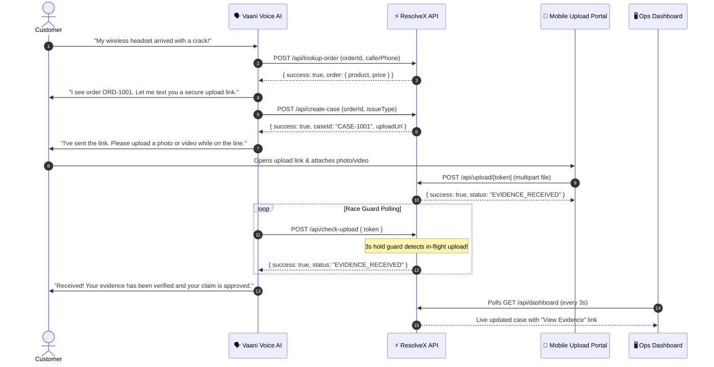

# 🎙️ ResolveX — Voice AI Customer Resolution Engine

<div align="center">

[](https://nextjs.org/)
[](https://www.typescriptlang.org/)
[](https://tailwindcss.com/)
[](https://vaani.dev/)
[](https://resolvex-three.vercel.app)

**An autonomous voice-driven dispute resolution agent that verifies customer orders, generates one-time secure upload portals, and eliminates upload race conditions in real time.**

[🌐 Live Demo](https://resolvex-three.vercel.app) • [📊 Agent Ops Dashboard](https://resolvex-three.vercel.app/dashboard) • [📦 GitHub Repository](https://github.com/vedha-333/ResolveX)

---

</div>

## 💡 The Problem & Our Solution

When customers call support regarding damaged, defective, or missing items:
1. **Traditional IVRs fail** at capturing real-time visual proof during an active phone call.
2. **Race conditions occur** when a voice assistant asks a caller to submit photos while holding on the line — if the voice bot checks the database too quickly, it misidentifies the upload as failed before the customer finishes submitting.

### ✨ ResolveX's Approach
- **Instant Voice Verification**: Vaani Voice AI calls ResolveX's webhook to look up the order and authenticate the caller in milliseconds.
- **Secure Visual Evidence Portal**: Generates a single-use tokenized upload URL delivered immediately to the caller via SMS/voice.
- **Race-Condition Hold Guard**: Implements a dedicated server-side hold guard (`3-second hold & re-check`) so the voice bot never drops the call or reports a false negative while a customer upload is in flight.
- **Serverless-First Storage**: Built with Upstash Redis REST and a resilient `/tmp` + in-memory store fallback, preventing read-only filesystem (`EROFS`) issues on Vercel serverless.
- **Live Ops Dashboard**: Support leads can watch claims stream in real time with auto-refreshing evidence badges and direct media viewers.

---

## 🏗️ Architecture & Interaction Flow



---

## ⚡ Vaani Custom Tools (Setup & cURL Commands)

In your **Vaani AI Console** (`Design → Tools & Actions → Create Custom Tool`), click **`>_ Paste cURL`** and paste these commands directly:

### 1. `lookup_order`
Validates an order by ID for the calling user.
```bash
curl -X POST https://resolvex-three.vercel.app/api/lookup-order \
  -H "Content-Type: application/json" \
  -d '{"orderId": "ORD-1001", "callerPhone": "9876543210"}'
```
- **Response Schema (Success):**
  ```json
  {
    "success": true,
    "order": {
      "product": "Wireless Headset",
      "price": 1499
    }
  }
  ```
- **Response Schema (Not Found):**
  ```json
  {
    "success": false
  }
  ```

---

### 2. `create_case`
Initializes a new claim and issues a 24-hour expiring upload portal token with dynamic host resolution.
```bash
curl -X POST https://resolvex-three.vercel.app/api/create-case \
  -H "Content-Type: application/json" \
  -d '{"orderId": "ORD-1001", "issueType": "DAMAGED_PRODUCT", "description": "Left earphone cracked on arrival"}'
```
- **Response Schema:**
  ```json
  {
    "success": true,
    "caseId": "CASE-1001",
    "uploadUrl": "https://resolvex-three.vercel.app/upload/d3b07384-d113-4632-a567-336c1e592671"
  }
  ```

---

### 3. `check_upload`
Polled by Vaani while the user is uploading evidence. Implements an automatic **3-second race-condition hold guard**.
```bash
curl -X POST https://resolvex-three.vercel.app/api/check-upload \
  -H "Content-Type: application/json" \
  -d '{"token": "d3b07384-d113-4632-a567-336c1e592671"}'
```
- **Response Schema:**
  ```json
  {
    "success": true,
    "status": "EVIDENCE_RECEIVED"
  }
  ```
  *(or `"status": "EVIDENCE_PENDING"` if upload is still pending)*

---

### 4. `POST /api/upload/[token]`
Multipart file receiver supporting videos and photos up to 50MB. Converts file data to base64, updates case to `EVIDENCE_RECEIVED`, and links evidence viewer.

---

### 5. `GET /api/evidence/[caseId]`
Streams uploaded visual evidence back inline (with matching MIME type) for dashboard review.

---

### 6. `GET /api/dashboard`
Real-time JSON feed of all cases, consumed by the ops dashboard every 3 seconds.

---

## 🔍 How to Confirm Vaani is Connected to Your Backend

To verify end-to-end communication between Vaani and ResolveX:

1. **Vaani Platform Checklist**:
   - Ensure the **System Prompt** is saved and you clicked **Save Agent**.
   - Verify all 3 tools (`lookup_order`, `create_case`, `check_upload`) are enabled under **Persona → Actions**.
2. **Watch Vercel Runtime Logs**:
   - Open your Vercel Dashboard → `resolvex-three` → **Logs**.
   - In Vaani Voice Lab or during a test call, say: *"Hi, my order ORD-1001 arrived damaged."*
   - You will see live incoming requests:
     ```text
     POST /api/lookup-order  200 OK
     POST /api/create-case   200 OK
     ```
3. **Check the Live Dashboard**:
   - Open [https://resolvex-three.vercel.app/dashboard](https://resolvex-three.vercel.app/dashboard) to watch the claim populate in real time!

---

## 📦 Demo Orders for Voice Testing

The storage layer comes preloaded with three test orders:

| Order ID | Product | Price | Status | Demo Phone |
| :--- | :--- | :--- | :--- | :--- |
| `ORD-1001` | **Wireless Headset** | ₹1,499 | `DELIVERED` | `9876543210` |
| `ORD-1002` | **Smart Watch** | ₹2,499 | `IN_TRANSIT` | `9876543211` |
| `ORD-1003` | **Cotton T-Shirt** | ₹499 | `DELIVERED` | `9876543212` |

---

## 🖥️ Pages & UI Features

| Route | Description |
| :--- | :--- |
| **`/`** | **Interactive API Tester & Simulator** — Test Vaani webhooks directly in your browser with real-time JSON responses. |
| **`/dashboard`** | **Live Agent Operations Dashboard** — Auto-polls every 3s, displaying live case statuses, total metrics, and direct evidence links. |
| **`/upload/[token]`** | **Customer Evidence Portal** — Mobile-optimized interface for camera/gallery capture with immediate visual confirmation: *"Received ✓ Your evidence has been attached to your case."* |

---

## 🚀 Quickstart & Local Setup

### 1. Clone the repository
```bash
git clone https://github.com/vedha-333/ResolveX.git
cd ResolveX
```

### 2. Install dependencies
```bash
npm install
```

### 3. Configure environment variables
Create a `.env.local` file:
```env
NEXT_PUBLIC_APP_URL=http://localhost:3000
PORT=3000

# Optional: Upstash Redis for persistent multi-region storage
# UPSTASH_REDIS_REST_URL=https://your-database.upstash.io
# UPSTASH_REDIS_REST_TOKEN=your-token-here
```

### 4. Run the development server
```bash
npm run dev
```
Open [http://localhost:3000](http://localhost:3000) to view the app.

### 5. Build for production
```bash
npm run build
npm run start
```

---

## 🛠️ Tech Stack

- **Framework**: [Next.js 14](https://nextjs.org/) (App Router, Route Handlers)
- **Language**: [TypeScript](https://www.typescriptlang.org/) (Strict Schema Enforcement)
- **Voice Platform**: [Vaani AI](https://vaani.dev/) (HTTP Tool Calls)
- **Styling**: [Tailwind CSS](https://tailwindcss.com/)
- **Icons**: [Lucide React](https://lucide.dev/)
- **Storage Layer**: Dual-mode Architecture (Upstash Redis REST + `/tmp` in-memory fallback for zero-failure serverless execution)
- **Deployment**: [Vercel](https://vercel.com/)

---

<div align="center">

Built with ❤️ for the Voice AI Hackathon.

</div>
